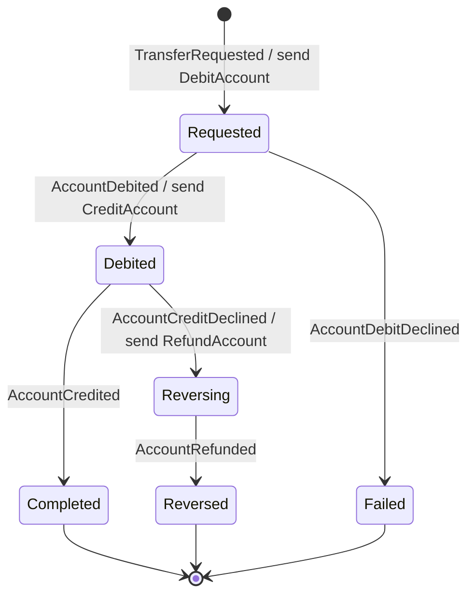

# EventBank Transfers

The Transfers microservice of [EventBank](https://github.com/marcelo-roman/eventbank-platform): transfers between accounts and PIX. A transfer touches two accounts owned by another service, so it cannot be one transaction: it runs as a saga, and the saga is an event-sourced aggregate.

## The saga

[`Transfer`](src/EventBank.Transfers.Domain/Transfer.cs) is a process manager. Each reply from the Accounts service moves it one step, and each step emits the next command.



Replies that arrive twice or out of order are ignored, so redelivery from RabbitMQ is harmless.

Before accepting a transfer the service checks both accounts against a local `account_directory`, filled from the `AccountOpened` and `AccountClosed` messages. It never calls the Accounts service synchronously.

## PIX keys

[`PixKey`](src/EventBank.Transfers.Domain/Pix/PixKey.cs) is an aggregate whose stream id is derived from the key itself (a UUIDv5 of the normalized value). Two customers registering the same key at the same moment append to the same stream at version 0, and the event store lets exactly one of them win: uniqueness without a lock table.

- Keys are CPF, e-mail, phone (`+55` and 10 or 11 digits) or random (UUID).
- CPF and e-mail keys must be the account holder's own, checked against a customer directory fed by `CustomerApproved`.
- An account holds at most five keys; a removed key can be registered again, by anyone.
- Looking a key up shows a masked key and a short name (`Bruno C.`), never the account.
- `POST /pix/transfers` resolves the key and starts the same saga as any transfer.

## Layers

| Project | Holds |
| --- | --- |
| `EventBank.Transfers.Domain` | The `Transfer` aggregate, `Money`, `Currency`, `AccountReference` and the events |
| `EventBank.Transfers.Application` | The transfer request, one command per saga reply, the directory commands, queries, and the `IAccountDirectory` and `ITransferReadStore` ports |
| `EventBank.Transfers.Infrastructure` | EF Core read model and directory, the projection, and the mapping from saga events to `DebitAccount`, `CreditAccount` and `RefundAccount` |
| `EventBank.Transfers.Api` | Minimal API endpoints and one RabbitMQ consumer per reply |

`Money` and `Currency` are deliberately not shared with Accounts: each bounded context owns its model.

## API

| Method | Path | Side |
| --- | --- | --- |
| `POST` | `/transfers` | command; only from your own account; answers 202 because the saga continues asynchronously |
| `GET` `POST` | `/pix/keys` | your keys / register one |
| `DELETE` | `/pix/keys/{key}` | remove one of your keys |
| `GET` | `/pix/keys/lookup?key=…` | who a key belongs to, masked |
| `POST` | `/pix/transfers` | send a PIX to a key |
| `GET` | `/transfers`, `/transfers/{id}` | read model; customers see the transfers that touch their accounts |
| `GET` | `/transfers/{id}/events` | event stream |
| `GET` | `/ops/subscriptions` | checkpoint and lag of each subscription |
| `POST` | `/ops/subscriptions/read-models/rebuild` | drop the read model and replay every event |

## Running

Same as [eventbank-accounts](https://github.com/marcelo-roman/eventbank-accounts#running): restore the EventBank packages from GitHub Packages or from the local feed built by `eventbank-platform/scripts/local-feed.sh`.

```bash
docker compose up -d            # PostgreSQL on 55432 and RabbitMQ on 5672
dotnet run --project src/EventBank.Transfers.Api  # http://localhost:5102
dotnet test
```

## License

[MIT](LICENSE)
