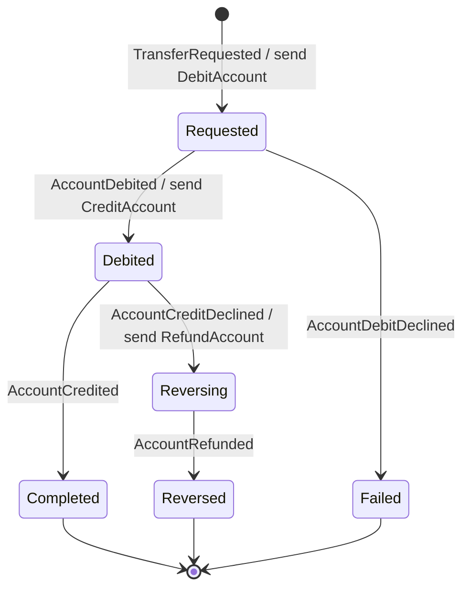

# EventBank Transfers

The Transfers microservice of [EventBank](https://github.com/marcelo-roman/eventbank-platform). A transfer touches two accounts owned by another service, so it cannot be one transaction: it runs as a saga, and the saga is an event-sourced aggregate.

## The saga

[`Transfer`](src/EventBank.Transfers.Domain/Transfer.cs) is a process manager. Each reply from the Accounts service moves it one step, and each step emits the next command.



Replies that arrive twice or out of order are ignored, so redelivery from RabbitMQ is harmless.

Before accepting a transfer the service checks both accounts against a local `account_directory`, filled from the `AccountOpened` and `AccountClosed` messages. It never calls the Accounts service synchronously.

## Layers

| Project | Holds |
| --- | --- |
| `EventBank.Transfers.Domain` | The `Transfer` aggregate, `Money`, `Currency`, `AccountReference` and the events |
| `EventBank.Transfers.Application` | The transfer request, one command per saga reply, the directory commands, queries, and the `IAccountDirectory` and `ITransferReadStore` ports |
| `EventBank.Transfers.Infrastructure` | EF Core read model and directory, the projection, and the mapping from saga events to `DebitAccount`, `CreditAccount` and `RefundAccount` |
| `EventBank.Transfers.Api` | Minimal API endpoints and one RabbitMQ consumer per reply |

`Money` and `Currency` are deliberately not shared with Accounts: each bounded context owns its model.

## API

| Method | Path | Side |
| --- | --- | --- |
| `POST` | `/transfers` | command; answers 202 because the saga continues asynchronously |
| `GET` | `/transfers`, `/transfers?accountId=…`, `/transfers/{id}` | read model |
| `GET` | `/transfers/{id}/events` | event stream |
| `GET` | `/ops/subscriptions` | checkpoint and lag of each subscription |
| `POST` | `/ops/subscriptions/read-models/rebuild` | drop the read model and replay every event |

## Running

Same as [eventbank-accounts](https://github.com/marcelo-roman/eventbank-accounts#running): restore the EventBank packages from GitHub Packages or from the local feed built by `eventbank-platform/scripts/local-feed.sh`.

```bash
docker compose up -d            # PostgreSQL on 55432 and RabbitMQ on 5672
dotnet run --project src/EventBank.Transfers.Api  # http://localhost:5102
dotnet test
```

## License

[MIT](LICENSE)
